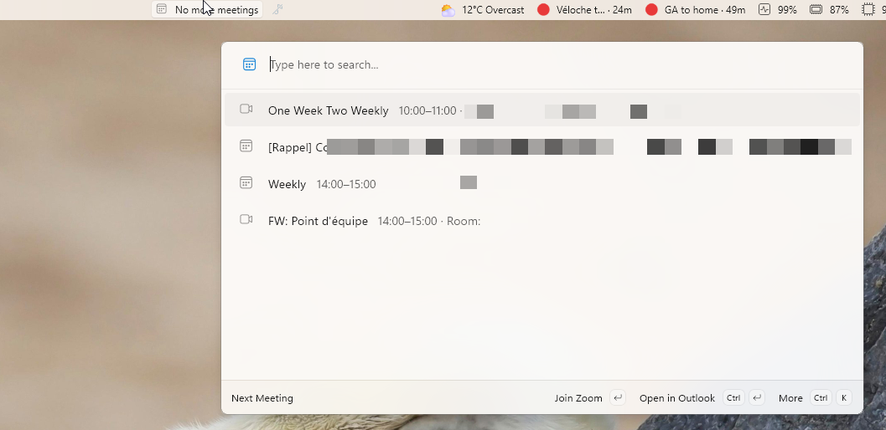

# Outlook (on-premises) 2019 meetings in your PowerToys Command Palette dock

Countdown to your next Outlook meeting, directly in the PowerToys Command
Palette **Dock**, with the meeting name and room next to it.

Built for **on-premises Outlook 2019** (works with any desktop Outlook profile).

## The dock



## What you get

**Dock band** (Title + Icon only, like every dock widget):

| State                 | Dock shows                | Icon   |
| --------------------- | ------------------------- | ------ |
| Meeting in progress   | `Subject · 23m left`      | green  |
| Next meeting > 15 min | `Subject · 47m`           | gray   |
| Next meeting ≤ 15 min | `⚠ Subject · 12m` + toast | orange |
| Nothing left today    | `No more meetings`        | gray   |
| Outlook unreachable   | `Outlook ⚠`               | gray   |

Hovering a band button shows the full details

**Palette page** (click the dock band): today's full agenda with per-meeting
countdown.

## Install from the latest release

The MSIX is signed with a self-signed certificate, so Windows must trust the
certificate before the package can install. Run this one-liner in PowerShell: it
downloads the `.cer` file from the release, imports it into
`LocalMachine\TrustedPeople` (accept the UAC prompt, admin is required for that
store), then installs the MSIX:

```powershell
Start-Process powershell -Verb RunAs -ArgumentList '-Command iwr https://github.com/maxerbox/powertoys-dock-outlook-meeting/releases/latest/download/OutlookMeetingDock.cer -OutFile $env:TEMP\OutlookMeetingDock.cer; Import-Certificate -FilePath $env:TEMP\OutlookMeetingDock.cer -CertStoreLocation Cert:\LocalMachine\TrustedPeople; Add-AppxPackage "https://github.com/maxerbox/powertoys-dock-outlook-meeting/releases/latest/download/OutlookMeetingDock_1.0.0.0_x64.msix"'
```

If the certificate is already trusted, install directly with:

```powershell
Add-AppxPackage "https://github.com/maxerbox/powertoys-dock-outlook-meeting/releases/latest/download/OutlookMeetingDock_1.0.0.0_x64.msix"
```

Then restart the Command Palette host (kill `Microsoft.CmdPal.UI`, it
auto-restarts, or relaunch via
`shell:AppsFolder\Microsoft.CommandPalette_8wekyb3d8bbwe!App`).

## Build & install

Requires the .NET 10 SDK and the Windows SDK 10.0.26100 (install it from Visual
Studio Installer or the standalone SDK installer).

```powershell


dotnet publish OutlookMeetingDock\OutlookMeetingDock.csproj -c Release -r win-x64 `
  -p:Platform=x64 -p:GenerateAppxPackageOnBuild=true -p:AppxPackageDir=..\AppxPackages -p:AppxBundle=Never

# Sign with your locally-trusted dev cert (adjust the thumbprint)
& "C:\Program Files (x86)\Windows Kits\10\bin\10.0.22000.0\x64\signtool.exe" sign /fd SHA256 `
  /sha1 <your-cert-thumbprint> AppxPackagesOutlookMeetingDock_1.0.0.0_x64_Test\OutlookMeetingDock_1.0.0.0_x64.msix

Add-AppxPackage AppxPackagesOutlookMeetingDock_1.0.0.0_x64_Test\OutlookMeetingDock_1.0.0.0_x64.msix
```

Then restart the Command Palette host (kill `Microsoft.CmdPal.UI`, it
auto-restarts, or relaunch via
`shell:AppsFolder\Microsoft.CommandPalette_8wekyb3d8bbwe!App`).
